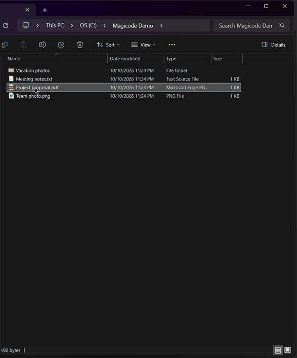

# Magicode Uploader

Upload files to [send.magicode.me](https://send.magicode.me) directly from the Windows Explorer context menu — right-click, and the download link is on your clipboard.



> **Unofficial.** This is an independent open-source tool for send.magicode.me. It is not made or endorsed by Magicode.

**[עברית למטה](#magicode-uploader---עברית)**

---

## Features

- **Windows Explorer integration** — Right-click any file or folder and select "Upload to Magicode"
- **Windows 11 modern context menu** — Appears in the top-level menu (not buried under "Show more options")
- **Works on Windows 10 too** — Falls back to the classic context menu where the Windows 11 menu isn't available
- **Files, folders and multiple selections** — Folders and multi-selections are zipped into a single archive before uploading
- **Clipboard integration** — The download URL is automatically copied to your clipboard
- **Notifications** — Shows the link when the upload completes (and progress for slow uploads)
- **Reliable uploads** — Large files are sent in chunks, and a dropped chunk is retried
- **No console window** — Runs silently in the background

## Installation

### From Release

1. Download `MagicodeUploader-Setup.exe` from the [latest release](../../releases/latest)
2. Run the installer

The installer sets up the context menu and registers all necessary components.

#### Why does the installer ask for administrator permission?

To appear in the **Windows 11 top-level menu**, a context-menu command has to be part of an app package. Windows only accepts an unsigned app package like this one when **Developer Mode** is turned on, so the installer turns it on (that is the UAC prompt). Developer Mode is a standard Windows setting (*Settings > System > For developers*) — it lets you install apps that aren't from the Microsoft Store.

If you decline the prompt, everything still works: "Upload to Magicode" just appears under **Show more options** instead of the top-level menu.

### Prerequisites

- **Node.js** (v18+) — [nodejs.org](https://nodejs.org)
- **Windows 10/11** (x64)

### Uninstall

Go to **Settings > Apps > Installed apps**, find "Magicode Uploader", and click Uninstall.

## Usage

Right-click any file or folder in Windows Explorer and select **"Upload to Magicode"**.

The file will be uploaded to [send.magicode.me](https://send.magicode.me), the download URL will be copied to your clipboard, and you'll see a notification when it's done.

For multiple files, select them all, right-click, and choose "Upload to Magicode" — they'll be zipped together automatically.

### Command Line

You can also use it from the command line:

```bash
node src/main.js <file1> [file2] [file3] ...
```

## Building from Source

### Prerequisites

- **Node.js 22** (21+ is needed for `npm test`; CI builds and tests with 22). Running the app only needs 18+.
- Visual Studio 2022 (with C++ desktop workload)
- Windows SDK
- [Inno Setup 6](https://jrsoftware.org/isinfo.php)

### Build the native DLL

```bash
npm run build:dll
```

### Build the installer

```bash
npm install
npm run pack
```

The GitHub Action handles all of this automatically when a version tag is pushed.

### Tests

```bash
npm test            # unit tests + end-to-end CLI tests against a local mock server
npm run test:live   # also upload to the real send.magicode.me and download it back
npm run test:shell  # drive the installed context menu through the Windows shell
```

`npm test` needs no network and runs in CI on every push. The end-to-end tests run the real CLI as a separate process with real zipping, real notification processes (logging to a file instead of showing a balloon) and the real clipboard, which they restore afterwards. `test:live` and `test:shell` upload small random test files to send.magicode.me.

## How It Works

| Component | Purpose |
|---|---|
| `src/main.js` | Uploads files, copies URL to clipboard, shows notifications |
| `src/win11/MagicodeNative.dll` | Native C++ IExplorerCommand handler that launches node.exe without a console window |
| `AppxManifest.xml` | Sparse MSIX package for Win11 context menu identity |
| `scripts/register-win11.ps1` | Registers the sparse package, or the classic fallback verb |
| `scripts/installer.iss` | Inno Setup script that builds the single-file installer |

The Win11 modern context menu requires a native COM DLL implementing `IExplorerCommand` plus a sparse MSIX package for app identity; the packaged command also shows under "Show more options". Where the package can't be registered (Windows 10, or Developer Mode declined), the same DLL is registered as a classic `ExplorerCommandHandler` verb instead. Either way the whole selection arrives in one call, so multiple files and folders are zipped into one upload.

Folders are zipped before uploading. Errors and uploaded links are logged to `upload.log` in the install folder.

## Releasing

Push a version tag to trigger the GitHub Action:

```bash
git tag v0.1.0
git push origin v0.1.0
```

The action builds the native DLL, creates the installer with Inno Setup, and publishes `MagicodeUploader-Setup.exe` to GitHub Releases.

---

<div dir="rtl" align="right">

## Magicode Uploader - עברית

העלאת קבצים ל-[send.magicode.me](https://send.magicode.me) ישירות מתפריט הלחיצה הימנית בסייר הקבצים של Windows — לחיצה ימנית, וקישור ההורדה כבר בלוח.

> **לא רשמי.** זהו כלי קוד פתוח עצמאי עבור send.magicode.me, ואינו מטעם Magicode.

### תכונות

- **שילוב בסייר הקבצים** — לחיצה ימנית על כל קובץ או תיקייה ובחירה ב-"Upload to Magicode"
- **תפריט מודרני של Windows 11** — מופיע בתפריט הראשי (לא מוסתר תחת "הצג אפשרויות נוספות")
- **עובד גם ב-Windows 10** — במקום שהתפריט של Windows 11 לא זמין, הפקודה מופיעה בתפריט הקלאסי
- **קבצים, תיקיות ובחירה מרובה** — תיקיות ובחירה של כמה פריטים מאוחדות לארכיון ZIP אחד לפני ההעלאה
- **העתקה ללוח** — קישור ההורדה מועתק אוטומטית ללוח
- **התראות** — הקישור מוצג בסיום ההעלאה (ובהעלאות ארוכות גם הודעת התקדמות)
- **העלאה אמינה** — קבצים גדולים נשלחים בחלקים, וחלק שנכשל נשלח שוב
- **ללא חלון קונסול** — רץ ברקע בשקט

### התקנה

#### מגרסה מוכנה

1. הורידו את `MagicodeUploader-Setup.exe` מ[הגרסה האחרונה](../../releases/latest)
2. הריצו את קובץ ההתקנה

ההתקנה תגדיר אוטומטית את תפריט הלחיצה הימנית ותרשום את כל הרכיבים הנדרשים.

#### למה ההתקנה מבקשת הרשאת מנהל?

כדי שהפקודה תופיע **בתפריט הראשי של Windows 11**, היא צריכה להיות חלק מחבילת אפליקציה. Windows מקבל חבילה לא חתומה כמו זו רק כש**מצב מפתח** (Developer Mode) מופעל, ולכן ההתקנה מפעילה אותו (זו בקשת ה-UAC). מצב מפתח הוא הגדרה רגילה של Windows (*הגדרות > מערכת > למפתחים*) שמאפשרת להתקין אפליקציות שלא מה-Microsoft Store.

אם תסרבו לבקשה, הכול עדיין עובד: "Upload to Magicode" פשוט יופיע תחת **הצג אפשרויות נוספות** במקום בתפריט הראשי.

#### דרישות מקדימות

- **Node.js** (גרסה 18 ומעלה) — [nodejs.org](https://nodejs.org)
- **Windows 10/11** (x64)

### הסרה

היכנסו ל**הגדרות > אפליקציות > אפליקציות מותקנות**, מצאו את "Magicode Uploader" ולחצו על הסר התקנה.

### שימוש

לחצו לחיצה ימנית על כל קובץ או תיקייה בסייר הקבצים ובחרו **"Upload to Magicode"**.

הקובץ יועלה ל-[send.magicode.me](https://send.magicode.me), קישור ההורדה יועתק ללוח, ותקבלו התראה כשההעלאה תסתיים.

לקבצים מרובים — בחרו את כולם, לחצו לחיצה ימנית ובחרו "Upload to Magicode" — הם יאוחדו לקובץ ZIP אוטומטית.

</div>
